# Peta RE untuk gameplay utama dan konversi aset

**Status: 7 November 2026.** Dokumen ini menetapkan cakupan reverse engineering yang diperlukan agar implementasi game utama kelak mempunyai spesifikasi dan sumber data yang dapat ditelusuri. Dokumen ini tidak membangun atau mengubah proyek Godot.

Target cerita adalah ACNH dasar yang direpresentasikan oleh input lokal, terutama alur New Game sampai konser K.K. pertama, lalu membuka loop pulau. Pekerjaan sampingan dapat menyusul. Pemetaan struktural data yang tersedia luas, tetapi semantik game masih parsial: `output/coverage.json` secara eksplisit mencatat `full_user_goal_completed=false`. Kesimpulan di sini dibatasi pada dump, modul native, dan referensi yang tercatat di repo.

Indeks bukti terbaru untuk tiap rantai gameplay inti ada di [CORE_GAMEPLAY_PROOF_INDEX_20261107.md](CORE_GAMEPLAY_PROOF_INDEX_20261107.md), dengan enam ledger tambahan untuk registrasi/peta, actor-aset, gerak/terrain, item-crafting, placement bangunan, dan gate progres cerita. Indeks tersebut memisahkan apa yang sudah source-backed dari sambungan runtime yang masih terbuka.

Rencana rinci untuk menghubungkan tiap beat cerita ke actor, penempatan dunia, UI, animasi, model, teks, audio, dan bukti konversinya ada di [CORE_GAMEPLAY_STORY_ASSET_PLAN.md](CORE_GAMEPLAY_STORY_ASSET_PLAN.md). Dokumen itu menetapkan urutan berikutnya dari prolog dahulu lalu hari kedua sampai K.K.; model/audio tetap berupa referensi katalog selama arsip sumber tidak tersedia.

Ketersediaan sumber dan pipeline konversi per kelas dirinci di [STORY_ASSET_INVENTORY_CROSSWALK_20261107.md](STORY_ASSET_INVENTORY_CROSSWALK_20261107.md); manifest gabungan beat dan part ada di [`output/gameplay/story_asset_crosswalk.json`](../output/gameplay/story_asset_crosswalk.json).

Bukti rinci gerak, ground, navigasi terrain, mutasi grid, dan urutan placement cerita ada di [WORLD_TERRAIN_MOVEMENT_PROOF_20261107.md](WORLD_TERRAIN_MOVEMENT_PROOF_20261107.md). Helper native terbatas dan urutan EventFlow sudah dipetakan; rantai kontrol pemain→collision→traversal→placement masih `OPEN`, termasuk query collider yang berhenti karena fixture world-root belum tersedia.

## Cara membaca status bukti

| Label | Arti dan batas |
|---|---|
| **STRUCT** | Format, ukuran, field mentah, atau hubungan data dibaca dan diperiksa. Ini belum membuktikan arti gameplay. |
| **TBL** | Nilai berasal langsung dari tabel lokal yang di-decode. |
| **EF** | Urutan aksi, query, cabang, dan subflow terlihat dalam graf EventFlow. Node action/query belum otomatis membuktikan perilaku handler. |
| **NATIVE** | Instruksi fungsi asli dijalankan lewat harness. Setiap hasil tetap dibatasi fixture, stub, dan fungsi yang disebut di dokumen uji; ini bukan eksekusi game lengkap. |
| **PSEUDO** | Hubungan dan perilaku disimpulkan dari disassembly/pseudocode, belum dibuktikan lewat eksekusi native yang sesuai. |
| **CROSS** | Cocok dengan sumber publik atau versi lain; berguna sebagai petunjuk, bukan bukti semantik lokal 1.0.0. |
| **CAT** | Hanya metadata katalog nama/format/path. Bukan file aset dan bukan bukti bahwa berkas konversinya tersedia. |
| **OPEN** | Bukti yang diperlukan belum ditemukan atau batasnya belum ditutup. |

Untuk klaim penting, catat sumber bytes/hash, fungsi atau tabel, fixture uji, apa yang dikendalikan harness, hasil, serta batas yang tersisa. Jangan menaikkan **PSEUDO**, **CROSS**, atau **CAT** menjadi perilaku terbukti tanpa bukti tambahan.

## Alur cerita dan bahan RE per tahap

| Tahap cerita | Yang sudah dipetakan | Bukti/gap yang harus ditutup sebelum spesifikasi dianggap siap dipakai |
|---|---|---|
| Boot dan New Game | `System_BootSequence`, `System_Title`, serta entry NewGame/Continue dan perpindahan stage terbaca. **EF**. | Urutan native pemuatan save, pembuatan save baru, perpindahan stage, dan pemulihan setelah keluar belum menjadi satu trace teruji. Petakan semua action/query yang benar-benar dicapai dari entry NewGame; tidak perlu menerjemahkan seluruh 456 flow untuk membuktikan jalur ini. Rujukan: [GAMEPLAY_FLOW §0](GAMEPLAY_FLOW.md#0-boot-dan-siklus-sistem). |
| Hari pertama: pilihan dan kedatangan | Pemilihan belahan bumi, nama/tanggal lahir, karakter, peta, pendaftaran pemain, kedatangan, tenda, NookPhone, aplikasi Map/ensiklopedia, dua villager awal, ranting/buah, api unggun, dan mimpi K.K. sudah ditelusuri melalui flow. **EF/TBL**. | Makna dan penulis flag yang tidak dibuat EventFlow, pembuatan/pemilihan pulau native, spawn awal, inventory awal, pemasangan tenda, serta syarat transisi pagi perlu dibuktikan atau diberi batas **OPEN**. Pesan dan label ada; gambar, model, animasi, dan suara prolog tidak ikut otomatis tersedia. |
| Hari kedua: tutorial DIY | Workshop, bahan ranting, pembelajaran resep dan pembukaan app resep tercatat. **EF**. Tabel resep memiliki join yang diaudit. | Panggilan belajar resep → marker save, bahan → craft → hasil, kegagalan, dan interupsi harus tersambung native pada fixture save yang lengkap. UI workbench belum terbukti sebagai satu siklus input sampai hasil. Rujukan: [CRAFTING_TRANSACTION_FOLLOWUP](CRAFTING_TRANSACTION_FOLLOWUP.md), item `crafting-diy` di [re_queue.json](re_queue.json). |
| Biaya pindah, rumah pertama, donasi awal | Gate 5.000 Nook Miles, upgrade rumah, donasi lima makhluk, pembukaan ensiklopedia, dan kit tenda museum terbaca di flow. **EF/TXT**. Sebagian helper dan nominal pinjaman mempunyai bukti tambahan. | Perubahan saldo/loan, eligibility tiap item, transaksi donasi, serializer, dan efek sesudah reload belum terbukti sebagai jalur menyeluruh. Museum menyimpan marker donatur pada offset yang ditelusuri, tetapi mapping row runtime dan trace save nyata ke ambang pembangunan masih **OPEN**. Rumah/HHA bukan syarat inti konser, tetapi biaya rumah dan query level diperlukan untuk membuka quest toko. |
| Nook's Cranny | Permintaan material, empat kelompok × 30 bahan, kit, pengumuman pembukaan, dan pembukaan quest tiga rumah terbaca. **EF**. Builder stok dan sejumlah hubungan tabel/pemilih stok telah dipetakan. | Processor native toko `0xfc4560` dan pembaruan stok belum lulus jalur penuh. Filter selector stok level 2/3, seed, dan keanggotaan record tertentu masih terbuka. Buktikan kapan pemasangan kit mengubah state/fasilitas dan flag pengumuman pada pergantian hari. |
| Jembatan, tangga, tiga plot, dan villager baru | Flow pemberian resep bridge/ladder/plot, kebutuhan tiga furnitur interior per plot, pemeriksaan furnitur luar, penyelesaian tiap plot, dan hadiah pagar terbaca. **EF/TBL**. Pemilih calon pindah masuk/keluar dan pool tabel villager mempunyai banyak uji native terkontrol. | Transaksi crafting/penyerahan, aturan penempatan kit dan furnitur, `IsSettlerQuestOutsideComplete`, `CompleteSettlerQuestSubject`, `DecideSettlerNpc`, flag Complete/Invited, pemetaan calon ke slot rumah dan waktu pindah harus ditutup. Jalur AI menentukan siapa yang bisa diajak bicara juga belum lengkap. |
| Resident Services dan Isabelle | Gate penyelesaian tiga plot/jumlah rumah, kabar renovasi, pengenalan Isabelle, pengumuman dan upacara tercatat. **EF**; sebagian pembaruan fasilitas dibaca dari pseudocode. | Konstruksi kantor, perubahan bangunan tenda→gedung, state kantor lokal, dan hubungan save/fasilitas/pengumuman belum sepenuhnya dieksekusi native. Buktikan kapan plaza dan kalender event menjadi aktif. |
| Campsite dan pengunjung pertama | Pemberian kit campsite, permintaan menemui camper, kit rumah camper pertama, lalu pembelian plot tambahan terbaca. Jadwal pengunjung mingguan dan sejumlah keputusan villager punya verifikasi native. | Hubungkan pemasangan campsite → processor pergantian hari → event camper → identitas villager → pembangunan rumah dalam satu skenario save. Pemanggil/spawn position beberapa NPC tetap **PSEUDO**; AI talk dan proses async navigasi masih parsial. |
| Rating pulau dan konser pertama K.K. | Ambang Nature/Life, penalti, jumlah rumah, tabel bintang dan pembuka konser ditelusuri. Tambahan classifier/cell counter, penalti duplicate, weight leaves dan save-copy native cocok pada fixture sintetis; empat skenario skor Natural/Life sesuai formula terdokumentasi ([audit skor](ISLAND_SCORE_REMAINDER_20261107.md)). **EF/PSEUDO/NATIVE parsial**. | Belum ada uji native end-to-end yang menjalankan agregator `0x15c61f0` → evaluasi Isabelle → unlock K.K. pada save lengkap. Perlu konfirmasi query `VillageScoreVeryMessy`, seluruh classifier berbasis tabel/item asli, dua sisi rating, batas 3 bintang, jumlah rumah, tanggal konser, serta urutan performance/credits. |
| Sesudah konser dan Island Designer | EventFlow menautkan undangan Tom Nook, lagu, dan pembukaan lisensi Island Designer. Loop sesudah konser dan beberapa syarat K.K. sudah dipetakan. **EF**. | Pemicu staff roll berada di luar aksi EventFlow; Island Designer memerlukan verifikasi input → preview → validasi → commit/rollback → save. Water/terraform dan placement masih **OPEN**. Jadi alur cerita sampai unlock sudah terpetakan, tetapi penggunaan editor setelah unlock belum cukup terbukti. |

Rujukan utama: [GAMEPLAY_FLOW.md](GAMEPLAY_FLOW.md), [GAMEPLAY_SCENARIO.md](GAMEPLAY_SCENARIO.md), indeks flag `output/gameplay/flag_index.json`, tree flow `output/gameplay/trees/`, dan perilaku native/pseudocode di `output/gameplay/native_flag_refs.json`. Label **EF** membuktikan graf dan bukan implementasi handler.

```mermaid
flowchart LR
  A[New Game dan kedatangan] --> B[Hari 1: orientasi dan api unggun]
  B --> C[Hari 2: DIY dan biaya pindah]
  C --> D[Rumah pertama dan Nook's Cranny]
  D --> E[Jembatan, tiga plot, villager baru]
  E --> F[Resident Services dan Isabelle]
  F --> G[Campsite dan camper pertama]
  G --> H[Penilaian pulau: target 3 bintang]
  H --> I[Konser K.K. pertama dan Island Designer]
  I --> J[Loop pulau bebas; terraforming masih perlu RE]
```

## Sistem yang menjadi dependensi jalur utama

| Kelompok | Sudah dibuktikan/dipetakan | Yang masih perlu RE sebelum kelak dapat dijadikan aturan gameplay |
|---|---|---|
| Cerita, flags, action/query | 456 EventFlow dan indeks 1.555 flag; cabang Bool memiliki konsistensi 466/474 pada sampel yang dijaga; entry/progres cerita utama ditelusuri. | Banyak action/query hanya nama dan parameter graf. Perilaku handler, penulis flag native, stage dispatch, dan cabang yang bergantung pada hasil subflow harus ditutup untuk flow jalur utama. 693 flag tidak mempunyai penulis EventFlow; angka ini bukan berarti 693 blocker, tetapi perlu klasifikasi pemilik/efeknya. |
| Save, tanggal, dan pergantian hari | Layout save native direkonstruksi; batas hari 05:00 dan beberapa jadwal/processor diuji. Urutan sebagian processor tercatat. | Nama semantik seluruh node/member, serialisasi/flush, pembuatan save, migrasi, rollback, pengambilan state sebenarnya, serta interaksi seluruh processor dengan skenario cerita belum teruji end-to-end. Banyak pseudocode masih memakai accessor terkendali. |
| Pulau, terrain, pantai, air | Preset dan banyak hubungan terrain/pantai ditelusuri; selector template dan beberapa consumer/assembler punya uji native. 13/13 unit PBC yang terpakai tercatat pada audit terdahulu; konsumen tinggi diuji pada prefix payload yang direkonstruksi. Reproduksi loader terbatas lulus 7 assertion dan 8 draw RNG. Release region→mutator rectangle juga dijalankan sampai mengubah 9 cell fixture; hubungan langsung ke aksi MakeFall/BreakFall belum terbukti ([audit air/terraform](ISLAND_WATER_TERRAFORM_REMAINDER_20261107.md)). | Generator/loader pulau dari seed, transform dunia penuh, konversi record preset 14-byte ke runtime 52-byte, raw PBC dan lifecycle resource, seam/render/collision pantai, tinggi semua permukaan, sungai/air terjun/simulasi air, serta edit live belum terintegrasi atau belum terbukti. Tidak ada member/file bernama PBC pada arsip yang diperiksa, dan `acnh_manifests_drive.zip` yang dirujuk oleh audit 783 payload tidak ada di workspace. Lihat [bukti batas reproduksi](ISLAND_LOADER_REMAINDER_20261107.md), [component_coverage.json](../output/ui_island/component_coverage.json) dan frontier. |
| Fisika, gerak, dan pemeriksaan posisi | Helper posisi, root motion, balistik, proximity, terrain, region, dan beberapa respons collision telah diuji pada konteks rekonstruksi. Delapan kasus menjalankan penambahan posisi X/Z ([bukti](PLAYER_PHYSICS_REMAINDER_20261107.md)); 11 fixture membuktikan cabang setter vertikal terpilih pada `0xda86b0` ([bukti collision](COLLISION_REMAINDER_20261107.md)); tujuh menguji scalar interpolasi ke object property ([bukti gap pemain](PLAYER_MOTION_GAP_REMAINDER_20261107.md)); 12 fixture menjalankan cabang `0xdac780`, termasuk sink actor-Y dengan nilai S8 yang dikendalikan ([bukti post-motion](PLAYER_POSTMOTION_REMAINDER_20261107.md)). Percobaan `0x7bccf0` memakai register input caller yang cocok, tetapi berhenti ketika sandbox baru tidak mempunyai world-root/grid yang diinisialisasi; ini bukti batas harness, bukan hasil query collider ([bukti query](PLAYER_COLLIDER_QUERY_REMAINDER_20261107.md)). | Solver penetrasi/geometri, friction/moving body, arti semua collision mask, producer `0xdacc40`, query collider `0x7bccf0`/`0x7c5570`, asal record posisi real, sumber nilai sink Y, integrasi penuh input→gravitasi→kecepatan→landing, satuan/waktu/frame, pengumpulan kandidat dan predicate semua tipe belum lengkap. Batas saat ini ada di [`continuation_frontier.json`](../output/mechanics/continuation_frontier.json). |
| NPC, navigasi, dan percakapan | Jadwal mingguan, pool/pemilih villager, state registry dan sejumlah route/pathfinding/handoff native dipetakan. Ada 55 graf AI yang diekstrak. Pemilih counter talk diuji pada 12 kasus; guest-entry `0xc0c9e0`, host-entry `0xc0b510`, dan host-exit `0xc0c280` juga diuji pada cabang terbatas dengan konteks sintetis/terkendali ([audit NPC](NPC_STORY_REMAINDER_20261107.md), [guest-state](NPC_CONVERSATION_STATE_REMAINDER_20261107.md), [host-state](NPC_HOST_STATE_REMAINDER_20261107.md), [host-exit](NPC_CONVERSATION_UPDATE_REMAINDER_20261107.md)). | Scheduler aktivitas penuh, lifecycle request async/cancel/publish, target/steering, predicate aktor nyata, kedekatan/interaksi, host/guest admission, pemilihan pasangan, pemilihan topik dan efek hubungan belum ditutup. Probe host-exit hanya membuktikan lima field mentah dikosongkan pada cabang tertentu; tidak membuktikan arti semantiknya, transisi runtime, atau dialog/EventFlow. |
| Item, inventory, DIY, dan alat | 46.034 word item terhubung ke definisi atau sentinel; layout item 8 byte diketahui. Join resep/material lengkap pada korpus yang diuji. Loader counter/cache dan helper durability beberapa alat diuji. Cabang pocket 19/20 vs 20/20 terpetakan. Trace Apple mencapai `0xeff060→0xf9e410`, tetapi accessor asli menolak fixture karena record cache buatan berisi pointer di tempat index; jumlah tetap 9 dan konsumsi belum terbukti ([batas transaksi](CRAFTING_TRANSACTION_REMAINDER_20261107.md), [probe Apple](CRAFTING_MATERIAL_REMOVAL_REMAINDER_20261107.md)). Probe selector alat membuktikan body `0xe37760` dapat meminta state `0xb8` (`cToolBreakDemo`) bila predicate terkendali bernilai true; ambang wear nol dan tautannya ke EventFlow tetap **OPEN** ([audit alat](TOOL_MECHANICS_REMAINDER_20261107.md)). | Makna FreeParam tetap union bergantung tipe; wrapped/special paths, parent save wrapper, pembelajaran resep end-to-end, konsumsi bahan, award hasil live, rollback/interupsi, durability dispatch semua aksi, tool ring, penggunaan target, dan serializer inventory masih terbuka. |
| Fasilitas, toko, dan evaluasi | Beberapa state museum/toko/penjahit/campsite/konstruksi dibaca atau diuji per helper; skor Nature/Life telah disusun dari klasifikasi native/pseudocode. | Jalur processor harian penuh, stok native, settlement flag per bangunan, end-to-end skor, serta query batas rumah/donasi/plot harus diuji. Museum, rumah/HHA, katalog, Nook Miles, friendship dan turnamen tetap lane sampingan kecuali gate cerita bergantung padanya. |
| HUD/UI, input, dialog | Layout BFLYT dan banyak pane/track dibaca; string EventFlow banyak tertaut ke pesan. Renderer ScissorPane, hit-test, layout/page bindings, dan beberapa callback native dipetakan; lihat [UI/HUD RE](UI_HUD_REVERSE_ENGINEERING.md) dan [cakupan komponen](../output/ui_island/component_coverage.json). | Controller `cnt1/usd1`, fokus/input/modal lifecycle, renderer/clipping live, text substitutions, layout↔page, sinkronisasi state↔UI, animasi/state machine, dan visual kesetaraan belum penuh. Keberadaan layout tidak membuktikan interaksi aktif. |

Peta tujuh mekanik lengkap dan batas per topik ada di [FOCUS7_MECHANICS.md](FOCUS7_MECHANICS.md). Frontier terbaru menyebut **1.136.083 kasus helper/blok native**; jumlah tersebut tidak bisa diterjemahkan menjadi persentase sistem atau game selesai.

## Peta sumber dan konversi aset

Prinsip konversi untuk setiap kelas: **sumber mentah → decoder dengan versi/parameter tercatat → hasil konversi → crosswalk ID/name/hash → validasi terhadap consumer native/data → catat batas fidelity**. Jangan mengubah unit, axis, urutan, bitfield, atau nama ambigu tanpa bukti. Pertahankan `source_id`, hash sumber, offset/ID asli, dan bentuk raw agar hasil bisa dibangun ulang.

| Kelas | Sumber / pemakaian | Jalur konversi yang tersedia atau direncanakan | Status dan batas akurasi sekarang |
|---|---|---|---|
| BCSV, BYML, AAMP, item, resep, stage/weather | Parameter cerita, item, konfigurasi actor, stage, kalender, cuaca, resep, struktur, layout. | Gunakan `manifest.json` + decoder dan output resolved/typed; relasikan melalui ID asli dan descriptor terverifikasi. `DATA_CONTRACT.md` mendefinisikan byte item, tipe, provenance, raw blob, dan perbedaan candidate name. | Banyak sumber sudah diekspor serta divalidasi. 91 kolom BCSV tanpa descriptor persis dan 431 hash-key unik BYML masih belum pulih; nama terpulihkan tidak otomatis membuktikan semantik. |
| Peta pulau dan unit terrain | `FieldPreset*_LandMaking`, structure/item presets, `FieldLandMakingUnitModelParam`, outside template/parts, unit model/PBC. | Bentuk 112×96 grid dan pertahankan record 14 byte mentah; resolve unit ID→variasi→arsip/model; item preset tetap dalam koordinat grid sumber sampai transform dibuktikan; kaitkan tinggi/PBC lewat konsumen native. | Join struktural dan beberapa transform/consumer sudah teruji, tetapi loader/generator end-to-end, skala/transform penuh, raw PBC/lifecycle, semua material/height, coast seam dan river rendering tetap terbuka. Jangan menganggap JSON terrain sebagai scene 3D akurat. |
| Model 3D, skeleton, material, tekstur | Katalog menyediakan nama/metadata model; file model asli seharusnya berada di arsip `Model/*.zs|*.szs`, BFRES dan external BNTX. | Referensi importer `tools/reference/acnh_rip`: Yaz0/SARC → BFRES → GLB, BNTX → PNG/HDR, anim skeletal → JSON; PBC disalin sebagai `.phive`. Jaga unit/axis BFRES, LOD/flags dan extras material. | Katalog lokal 37.459 baris (5.627 menandai GLB+PNG) adalah **CAT**, bukan aset. `output/additional_romfs/summary.json` mencatat nol kecocokan path sumber katalog di RomFS tambahan; direktori/arsip Model tidak ada. Tidak ada hasil model yang dapat diverifikasi dari katalog. Exporter GLB saat ini hanya LOD0 dan slot tekstur PBR terbatas (`_a0`, `_n0`); parameter FMAT tambahan disimpan di extras. |
| Collision/physics assets | Arsip model biasanya memuat `.phive`; native memakai collision/terrain/ground records. | Pertahankan blob `.phive` asli dan hash sambil format/lifecycle dibaca; hubungkan collider dengan model/transform/actor melalui bukti runtime. | Exporter hanya menyalin `.phive` tanpa decode. File model mentah tidak tersedia di paket ini; seluruh mask, friction dan solver masih belum lengkap. |
| UI layout dan ikon | 523 BFLYT, 2.095 BFLAN UI, 431 BNTX container/3.336 texture record di tambahan RomFS; 356 `cnt1` dan 2.164 `usd1` belum semantik. | BFLYT→pane tree JSON; BFLAN→summary/raw section; BNTX→PNG lewat decoder; font scalable BFTTF→TTF/OTF dan BFFNT dipertahankan raw. Kaitkan `UIName`, page factory, pane, input map, localization key. | Struktur layout/animasi ada, tetapi renderer, material/shader penuh, input/focus/modal, interpolation/trigger/state machine, localization substitution dan perbandingan frame live belum lengkap. |
| Cerita/dialog/pesan | 965.426 label pesan pada 14 bahasa; banyak rujukan flow dan item dapat ditautkan ke label MSBT. | MSBT→JSON dengan label, teks, tag, dan bahasa; pertahankan label/path/suffix sebagai key. Resolve string→EventFlow node/actor/NPC, lalu parameter teks dan substitusi runtime. | Struktur dan sebagian besar join tersedia. Tag control, gender/number/player/NPC substitutions, fallback locale dan pemilihan label runtime belum dibuktikan menyeluruh. Teks tidak menyediakan visual/audio adegan. |
| Animasi actor/state machine | BFRES skeletal clips, BFLAN UI, 83 ASB state-machine files. | Skeletal clip di-sample per frame ke JSON; ASB diekspor sebagai state/transisi/condition/event/warp graph; kaitkan nama clip ke rig/model setelah arsip tersedia. | Struktur banyak terbaca, tetapi interpretasi condition/transition space/parameter, trigger, waktu, blend, root motion dan registry lengkap belum seluruhnya terverifikasi. |
| Audio/BGM/SFX/Animalese | Katalog berisi 17.410 baris nama/timing/channel; sumber asli semestinya BWAV dan BARS di `Sound/Resource`. | BWAV→WAV/OGG; BARS→BWAV entries lewat AMTA; simpan sample rate, channels, codec, sample count dan loop points di indeks; relasikan pemanggil audio ke flow/actor/animasi. | `output/additional_romfs/summary.json` juga mencatat nol kecocokan path sumber katalog di RomFS tambahan. Arsip audio mentah tidak ada di input; katalog adalah metadata saja. Pipeline reference ada, tetapi tidak ada waveform/audio yang dapat dipastikan atau dikonversi dari katalog. Loop offset setelah transcode lossy harus divalidasi dalam target runtime. |
| Shader, efek, cuaca/air | Ada sumber shader/efek terbatas, dua BFSHA archive dengan 1.889 slot metadata, dua VFXB/PTCL dan XLNK. | Simpan biner dan metadata; petakan material/BFSHA option→program→BNTX texture→consumer actor; decode shader hanya bila bytecode/source dan relokasi tersedia. | Slot/options belum sama dengan shader lengkap. PTCL/XLNK, water/foam, sky/weather render, vertex/pixel behavior dan material parity masih parsial. |

Jalur importer referensi ada di `tools/reference/acnh_rip/build.py` (`inventory`, `data`, `models`, `audio`, `ui`, `asb`) dan subfolder `formats/`/`exporters/`. Keberadaan kode importer berarti metodenya dapat direproduksi **jika sumber mentah tersedia**; bukan bukti bahwa semua konversi sudah dijalankan atau hasilnya lengkap.

## Antrean RE yang masih terbuka

`docs/re_queue.json` memiliki 15 item **open** dan 22 item selesai pada audit terakhir. Daftar ini adalah status tema, bukan klaim bahwa semua kebutuhan jalur utama berada pada satu prioritas. Prioritas praktis di bawah menimbang dependensi cerita utama; side lane tetap tercatat.

| Prioritas | Item terbuka | Yang perlu dibuktikan | Dampak ke target |
|---|---|---|---|
| P0 | `island-loader-end-to-end` | Seed/template → loader/cell transfer → transform dunia → preset aktual dan objek awal dalam satu harness. | Pulau tidak dapat direkonstruksi akurat hanya dari daftar preset. |
| P0 | `crafting-diy` | Wrapper save, recipe learn/set/reset, bahan→hasil, atomicity dan rollback dengan fixture player/UI lengkap. | DIY, bridge/ladder, plot furniture dan alat cerita. |
| P0 | `tool-mechanics` | Semua action-family wear, break-state dispatch, kondisi pemakaian, save dirty/flush dan tool-ring input. | Gathering dan aktivitas inti belum dapat dispesifikasikan penuh. |
| P0 | `villager-ai-talk` | Aktivitas, transisi host/guest, pemilih topic, jadwal↔interaksi, state quest dan hubungan. | Quest plot/camper serta percakapan utama berisiko tidak dapat dipicu benar. |
| P0 | `island-score-native` | Skor kategori 0–10 melalui fungsi native utuh, boundary cases, update pulau→evaluasi→unlock K.K. | Gate cerita tiga bintang belum terbukti secara eksekusi utuh. |
| P0 | `shop-processor-native` | State toko 0–3, pembaruan stok, construction, refresh hari, seed dan selector. | Nook's Cranny serta sebagian urutan progres/toko. |
| P0/P1 | `island-water-terraform` | Validasi/commit edit, mask air/sungai/air terjun, transform dan simpan. | Unlock Island Designer dapat dipetakan; penggunaan pasca-unlock belum. |
| P0/P1 | `ui-hud-renderer-runtime` | Trace pane/controller/input/focus/clipping ke pixel output dengan keadaan UI tersinkron. | Tindakan cerita harus dapat diakses/ditampilkan secara faithful. |
| P1 | `museum-donation` | Row donor runtime, real-save trace sampai processor pembangunan museum. | Museum sampingan; donasi awal tetap berhubungan dengan tutorial. |
| P1 | `weather-beyond-day-pattern` | Kode cuaca per jam, salju, special weather dan pemanggil/penerima event. | Fidelity lingkungan dan spawn/event tertentu. |
| P1 | `house-upgrade-hha` | Grade HHA, skor/overlap, mail queue dan reader; loan path sudah lebih terpetakan. | Rumah sampingan dan reward, bukan gate konser utama. |
| P1 | `catalog` | Trigger FillCatalog, order, mailbox delivery dan save registration. | Koleksi/belanja pasca-game utama. |
| P1 | `nook-miles-and-tourneys` | Daily quest, reward, pencapaian dan rumus turnamen. | Ekonomi/reward sampingan; biaya 5.000 miles pada cerita perlu dibuktikan lewat currency transaction. |
| P1 | `friendship-gain` | Delta interaksi/hadiah/surat, caps, decay, timing dan efek villager. | Simulasi sosial, bukan blocker konser. |
| P2 | `symbolic-leftovers` | Hanya nama yang bisa diselesaikan dengan bukti baru; selain itu tandai sebagai unresolved eksplisit. | Ketepatan simbolik/edge case; jangan menghambat semantik yang sudah diketahui. |

Daftar entry point, metode, batas harness dan syarat selesai per item berada di [re_queue.json](re_queue.json). Batas mekanik terkini berada di [continuation_frontier.json](../output/mechanics/continuation_frontier.json). Karena beberapa item bergantung pada agent/hasil pulau lain, cross-reference aktual disimpan di `HANDOFF.md`; tidak ada hasil yang boleh dianggap masuk jika belum ada file bukti lokal dan provenance-nya.

## Syarat untuk menyatakan bahan RE jalur utama matang

Sebuah bagian baru dapat diberi status **siap sebagai spesifikasi untuk implementasi** setelah:

1. jalur cerita yang mencapainya mempunyai entry, prasyarat, action/query, flag/state yang berubah, hasil gagal, dan kondisi pergantian hari yang tercatat;
2. tiap perilaku penting mempunyai bukti **NATIVE** yang batas fixture/stub-nya eksplisit, atau tetap ditandai **PSEUDO/OPEN** tanpa disamarkan sebagai fakta;
3. data yang dibaca kemudian bisa ditelusuri dari ID/hash dan tabel sumber ke consumer native atau flow;
4. konversi aset mempertahankan raw/provenance dan mempunyai validasi khusus kelas (grid/transform untuk world, rig/LOD/material untuk model, timing/loop untuk audio, pane/input/animasi untuk UI, label/substitution untuk teks);
5. seluruh dependensi yang diperlukan sampai konser K.K. memiliki satu matriks status dan tidak ada action/query kritis yang diasumsikan berhasil karena node-nya ada di EventFlow.

Dengan kriteria itu, status sekarang adalah **peta struktur dan alur utama sudah tersedia, tetapi spesifikasi gameplay utama belum matang penuh**. Blocker RE terbesar saat ini ialah penghubung EventFlow↔handler/state nyata, loader dunia/terraform, transaksi item/crafting/tool, villager interaksi, dan skor pulau end-to-end. Kekurangan aset model/audio berasal dari sumber mentah yang tidak tersedia; katalog tidak cukup untuk menyelesaikan konversinya.
